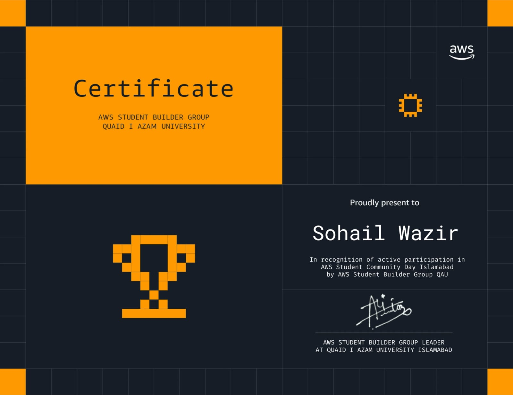

# Hi, I'm Muhammad Sohail 👋

I'm a Software Engineering student at **COMSATS University Islamabad**. I build web apps and I'm learning DevOps and AI.

- 🔭 Currently working on: **EventEase** (an event management web app) and the website for my perfume brand, **Preghal Fragrances**
- 🌱 Learning: React, Linux, Git, and cloud and DevOps basics
- 👨‍🏫 OOP Instructor at the Software Engineering Society, CUI
- 📫 Reach me on [LinkedIn](https://www.linkedin.com/in/muhammad-sohail-2381592bb)

### Tech I use

### Featured projects

| Project | What it is |
|---|---|
| [EventEase](https://github.com/sohailwazir2004/ease) | Event creation and management app (JavaScript, Flask) |
| [Portfolio](https://github.com/sohailwazir2004/my-portfolio) | My React portfolio · [live](https://my-portfolio-three-silk-27.vercel.app) |
| [Programming Fundamentals](https://github.com/sohailwazir2004/Programming-Fundamentals) | Java practice from my coursework |

### Certificates

**AWS Student Community Day Islamabad** — certificate of participation from the AWS Student Builder Group, Quaid-i-Azam University

